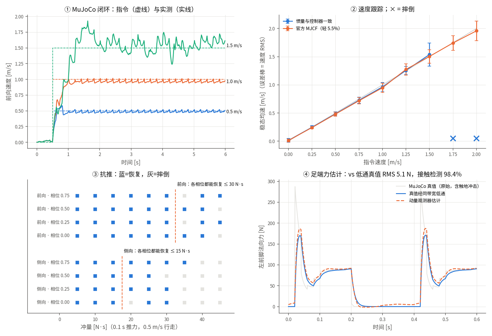

# 里程碑 11 —— MuJoCo 全身闭环与足端力估计

> 模块：`sim/`、`locomotion/`、`state_estimator/contact_force.py` · 机器人：Unitree Go2 · 状态：已完成，29 项测试通过
>
> 环境：conda `env_isaaclab_recovered`，MuJoCo 3.3.7，模型取自宇树官方 `unitree_mujoco`



---

## 1. 为什么要有这个里程碑

里程碑 7 和 8 各自都"验证过"，但验证方式有两个漏洞：

| 模块 | 之前的验证 | 漏洞 |
|---|---|---|
| M7 凸 MPC | 把求出的力喂回**单刚体模型**，稳态速度误差 0.0 mm/s | 被控对象就是预测模型本身。零误差说明"QP 解对了"，说明不了"狗能走" |
| M8 WBC | 单步物理判据：动力学残差 1e-8、力在摩擦锥内 | 只看一个时刻。没有接触切换、没有落地冲击、没有累积误差 |

**这两个 0 误差都是循环论证。** 要打破它，必须换一个**独立实现**的物理引擎当
被控对象 —— 它的接触模型、积分器、关节摩擦都与控制器无关。MuJoCo 就是这个
角色。

> 无人机类比：这相当于你在 PX4 SITL 里跑控制器，而不是把 NMPC 的输出喂回
> NMPC 自己的预测模型。后者只能证明求解器没写错。

---

## 2. 结论先放前面

**MPC + WBC 在 MuJoCo 里走起来了。** 以下所有数字都由 `scripts/eval_mujoco.py`
一条命令复现；仿真无随机性，同一台机器上逐位一致。

| 项 | 结果 |
|---|---|
| 速度跟踪（0.25–1.25 m/s，稳态） | 线速度 RMS **0.028–0.077 m/s**，均速偏差 ≤ 3.6% |
| 最高稳定速度 | 控制器模型参数：**1.5 m/s**（RMS 0.205，已贴力矩上限）；1.75 m/s 摔倒 |
| 5.5% 质量失配（官方 MJCF） | 0.5 m/s RMS 0.035（匹配时 0.037）—— **失配几乎不影响跟踪** |
| 抗推（0.5 m/s，0.1 s 推力，4 个相位取最差） | 侧向 **15 N·s**，前向 **30 N·s** |
| MPC 求解（单进程） | 中位 **3.5 ms**，p99 18 ms（50 Hz 预算 20 ms） |
| WBC 求解 | 中位 **0.037 ms**，p99 0.054 ms |
| 足端力估计（K=200，补转子惯量） | vs 同带宽真值 RMS **4.8 N**（支撑均值 78 N）|
| 接触检测 | 准确率 **99.5%**（步态计划只有 92.3%），摆动相误检 0.2% |

**要如实说明的限制**（第 8 节展开）：状态用的是仿真真值而不是 ESKF；MPC 在控制
线程里同步求解，所以 1 kHz 周期在 MPC 那一拍会超时；只测了平地；运输成本明显
高于 M9/M10 的 RL 策略。

---

## 3. 第一步：两只狗必须是同一只

闭环之前先回答："MuJoCo 里的狗，和 Pinocchio 里的狗，是不是同一只？"不是的话，
后面任何误差都分不清是控制器的锅还是模型的锅。

### 三处约定不同

| 量 | MuJoCo | Pinocchio（本仓库） |
|---|---|---|
| 四元数 | `[w, x, y, z]` | `[x, y, z, w]` |
| 基座线速度 | **世界系** | **机体系** |
| 执行器顺序 | SDK 顺序 **FR/FL/RR/RL** | —（直接给 12 维力矩） |

`sim/mujoco_go2.py` 在边界上把这些全部转掉，执行器**按关节名**映射，绝不按
位置对。`test_actuators_are_mapped_by_name` 逐个关节打一下，验证只有它自己加速。

### 数值对齐

| 检查 | 误差 |
|---|---|
| 足端位置（20 个随机位形） | 3 × 10⁻¹⁶ |
| 质量矩阵（速度约定换算、扣掉 armature 后） | 6.6 × 10⁻¹⁶ |
| 重力项 | 5.7 × 10⁻¹⁴ |

质量矩阵要换算是因为速度约定不同：MuJoCo 速度 = `T` · Pinocchio 速度，
`T = diag(R, I, I)`，所以 `M_pin = Tᵀ M_mj T`。动能不变量推出来的。

### 但质量参数对不上

| | 官方 MJCF | 本仓库 URDF |
|---|---:|---:|
| 总质量 | 15.21 kg | 16.09 kg |
| 躯干 | 6.921 | 7.279 |
| hip / thigh / calf | 0.678 / 1.152 / 0.241 | 0.767 / 1.241 / 0.194 |

两份都是宇树发布的。于是做成一个开关：`SimConfig(inertia="urdf")` 把 MuJoCo 的
惯性参数改写成 URDF 的值（与控制器逐连杆一致，用来先调通），`"mjcf"` 保留
**5.5% 的真实失配**（用来测鲁棒性）。

### 一个没完全搞清机理的坑：主轴顺序

改写惯量时要把 3×3 张量对角化成 MuJoCo 的"主惯量 + 主轴四元数"形式。
`np.linalg.eigh` 返回**升序**特征值。照原样写进去，结果：

* 质量矩阵与 Pinocchio 一致到 10⁻¹⁶（数学上完全正确）；
* 但 PD 站立会落入 **~100 Hz 的膝关节振荡**，整机以 0.5 m/s **倒退**；
* 换增益、换步长、关关节摩擦、改接触维度、改摩擦锥类型 —— 都不消失；
* 逐刚体替换定位到**小腿的惯量张量**；悬空（无接触）时不振荡；
* 把主轴改成**降序**（与宇树 MJCF 的写法一致）—— 振荡消失，5 组增益 × 7 个初始
  高度全部稳定。

两种排列还原出的张量差 6.5 × 10⁻¹⁹，所以这是 MuJoCo 内部对主轴顺序的**数值
敏感性**，不是参数错误。具体机理我没追到底（可能与接触求解器里按主轴计算的
某个量有关）。工程上的处理是：固定降序 + `test_pd_standing_comes_to_rest` 回归
测试（已验证：改回升序，该测试会失败 3 项）。

---

## 4. 闭环结构

```
状态 (q, v) ──┬── 步态调度 M4 ── 接触序列 ──┐
              ├── 落脚点 M6 ── 摆动轨迹 M5 ─┤
              │                              ├── 凸 MPC M7 (50 Hz) ── 接触力计划
              │                              │                          │
              └──────────── 全身 QP M8 (1 kHz) ◄─────────────────────────┘
                                 │
                        12 个关节力矩 → MuJoCo
```

`locomotion/controller.py` 就是这张图。前八个里程碑的代码**一行没改**，只有两处
接口扩展：WBC 的力矩上限支持逐关节数组（Go2 的 hip/thigh 是 23.7 N·m，膝是
45.43 N·m），以及闭环用的 MPC 权重（第 5 节）。

### 三个接缝处的设计

**1. 接触集合一变就重解 MPC。** MPC 50 Hz，两次之间用上一次的力计划。但如果
某只脚刚落地，它在最多 20 ms 内拿不到力；刚抬起的脚反而还被要求出力。所以
接触集合变化时立即重解一次。

**2. 躯干任务必须自己写。** Pinocchio 浮动基座的 `a[0:3]` 是**机体系**线速度的
导数，不是世界系加速度。世界系下躯干原点的经典加速度是

$$\ddot p = R\,(a_{0:3} + \omega_b \times v_b)$$

M8 自带的 `body_task` 直接把 `a[0:6]` 当目标，在 M8 的单步测试里没问题（躯干
水平、速度为零时两者相等），闭环里一转身就错。`test_body_task_is_world_frame_classical_acceleration`
拿 `pin.getFrameClassicalAcceleration` 逐位对照。

**3. Pinocchio 的足端坐标系在球心。** MuJoCo 的足端是半径 2.2 cm 的球，站在
地上时球心高 0.022 m 而不是 0。落脚点目标高度、躯干期望高度都要加上这个值，
否则摆动腿每一步都往地下踩 2 cm。

---

## 5. 调参：只动了一处

第一次闭环就能站、能原地 trot、能以 0.5 m/s 走。但 1.0 m/s 欠调（0.926）、
1.5 m/s 超调（1.715）。扫描 MPC 的水平位置 / 速度权重：

| 位置, 速度权重 | 0.5 m/s 均速 / RMS | 1.0 | 1.5 |
|---|---|---|---|
| 5, 12（M7 默认） | 0.47 / 0.042 | 0.91 / 0.121 | 1.58 / 0.149 |
| 5, 40 | 0.47 / 0.040 | 0.94 / 0.089 | 1.49 / 0.126 |
| **20, 40（采用）** | **0.48 / 0.036** | **0.95 / 0.084** | **1.50 / 0.117** |
| 50, 40 | 0.49 / 0.032 | 0.97 / 0.075 | 1.36 / 0.352 |
| 5, 100 | 0.48 / 0.036 | 0.95 / 0.079 | 摔倒 |

**为什么 M7 的默认值不够：** M7 的闭环里被控对象就是单刚体模型，零模型误差，
软权重就够了。换到全身物理后，摆动腿的动量、落地冲击这些**单刚体模型里不存在
的东西**要靠更硬的速度反馈压住。但太硬（速度 100）在高速时 QP 会给出贴着摩擦锥
边界的激进力，一步踩滑就摔。M7 的 `MPCConfig` 默认值没改（它的测试依赖它），
新权重放在 `LocomotionConfig`。

---

## 6. 足端力估计：广义动量观测器

### 问题

Go2 的脚上**没有力传感器**。WBC 需要知道哪只脚踩实了，而步态调度器只知道
"计划"哪只脚该踩实。实测两者差多少？

> 在 0.5 m/s trot 下，**步态计划与真实接触只有 92.3% 的时间一致**。剩下 7.7% 是
> 早落地、晚落地、落地后弹起 —— 都是 WBC 按错误的接触集合施加约束的时刻。

### 为什么不直接解动力学方程

$$J_c^\top f = M a + h - S^\top \tau$$

要**加速度** $a$ —— 只能对编码器速度做数值微分，1 kHz 下噪声放大约 1000 倍。

### 换一个变量：广义动量

$p = M(q)\,v$。利用 $\dot M = C + C^\top$（M2 里 `test_mdot_minus_2c_is_skew_symmetric` 验证过的性质）：

$$\dot p = S^\top\tau + C^\top v - g + \tau_{ext}$$

右边**没有加速度**。定义残差

$$r(t) = K\Big[p(t) - p(0) - \int_0^t \big(S^\top\tau + C^\top v - g + r\big)\,ds\Big]$$

代入即得 $\dot r = K(\tau_{ext} - r)$：**残差就是外力矩过一个带宽为 K 的一阶低通**。

外力只来自四只脚，$\tau_{ext} = J_c^\top f$，$J_c$ 是 12×18 —— 18 个方程 12 个
未知数，最小二乘。**浮动基座那 6 行是关键信息**：它们让"哪只脚在出力"可分辨，
即使那只脚的关节力矩很小。

> 无人机类比：这就是你做过的**外力 / 风扰观测器**，$m\dot v = Rf_T + mg + f_{ext}$。
> 区别是四足的外力作用在四个不同点上，要靠 $J_c^\top$ 拆回每只脚。

### 怎么评估才公平

MuJoCo 真值在触地瞬间有 **293 N 的冲击峰**（静态分担约 78 N），约 20 ms 衰减完
（图 ④ 灰线）。一阶低通观测器按构造就跟不上它，拿原始真值比 RMS 会得到 26–56 N，
但这个数字衡量的是"低通滤波器能不能跟上冲击"，不是估计器好不好。

所以主指标是 **vs 同带宽低通后的真值**（观测器理想情况下应该输出的东西），辅以
**接触检测**这个下游真正要用的量。

### 结果（0.5 m/s trot，官方 MJCF 参数）

| K | 转子惯量 | vs 低通真值 RMS | 接触检测准确率 | 触地 / 离地延迟 | 摆动相误检 |
|---:|---|---:|---:|---:|---:|
| 50 | 不补 | 7.0 N | 93.9% | −1 / 23 ms | 11.7% |
| 50 | 补 | 5.5 N | 94.7% | 1 / 20 ms | 9.7% |
| 100 | 不补 | 8.3 N | 97.8% | **−7.5** / −1 ms | 3.7% |
| 100 | 补 | 5.1 N | 98.4% | 0 / 6 ms | 3.0% |
| 200 | 不补 | 10.1 N | 95.1% | **−13.5** / −6 ms | 6.6% |
| **200** | **补** | **4.8 N** | **99.5%** | **0 / −1.5 ms** | **0.2%** |
| 步态计划 | — | — | 92.3% | — | — |

1.0 m/s 下（K=100，补）：RMS 7.5 N，检测 96.3%。

### 读法

**转子惯量是这张表的主角。** 不补时，K 越大误差越大 —— 高带宽把未建模项一起放大
了。负的触地延迟（−7.5、−13.5 ms）是**提前误报**：摆动腿落地前在减速，电机转子
的惯性力矩被观测器读成了"地面在推脚"。补上之后，K 越大越好，K=200 时误检率
从 6.6% 降到 0.2%。

转子惯量（armature，Go2 约 0.01 kg·m²，即转子惯量 × 减速比²）**不在 URDF 里**，
但它是电机手册上的已知参数 —— 补它不是作弊。这对真机很有参考价值：用 URDF 做
力估计，第一个要补的就是这一项。

**+2.2 N 的常值偏置**来自质量失配：官方 MJCF 比控制器模型轻 0.88 kg，
8.6 N ÷ 4 只脚 = 2.2 N。观测器"看见"了模型质量误差 —— 这是它的一个副产品：
偏置可以用来在线辨识负载质量。

---

## 7. 实时性

单进程、同步执行（MPC 在 WBC 线程里求解），0.5 与 1.0 m/s 各 6 秒：

| | 中位 | p99 | 预算 |
|---|---:|---:|---:|
| MPC（N=10，120 变量） | 3.46 ms | 18.0 ms | 20 ms（50 Hz） |
| WBC（18–30 变量） | 0.037 ms | 0.054 ms | 1 ms（1 kHz） |
| 整个控制周期 | 0.40 ms | **7.7 ms** | 1 ms |

**控制周期 p99 超了 1 ms 预算** —— 因为 MPC 那一拍是在同一个线程里算的。真机上
MPC 必须放独立线程（MIT Cheetah 的做法），WBC 读最近一次的力计划。本仓库的
仿真是逐步推进的，同步执行不影响结果正确性，只影响"能不能说 1 kHz 实时"——
**不能**，这一条不写进简历。

> 注意：评估脚本的速度/抗推实验在 24 进程并行池里跑，那里测到的 MPC 中位
> 19.6 ms 是 CPU 争用的结果。计时必须单进程单独跑，脚本已这样处理。

---

## 8. 局限（逐条，按严重程度）

1. **状态是真值。** 控制器直接读 MuJoCo 的 (q, v)。M3 的 ESKF 还没接进来 —— 下一步
   的工作。接进来后，姿态偏置（M3 测到的 0.3°）和速度噪声会进入 MPC。
2. **接触检测没有回注控制器。** 第 6 节的估计是离线回放（观测器因果、结果与在线
   等价），但 WBC 仍按步态计划施加接触约束。把检测结果接回 WBC 是下一步。
3. **只有平地。**
4. **运输成本偏高。** 0.75 m/s 下 CoT 1.07，而 M9 的 RL 策略在 Isaac 里平均速度
   0.756 m/s 时 CoT 0.664（公式相同，但仿真器和指令分布不同，只能粗比）。主要来源
   是摆动腿的高增益笛卡尔 PD（Kp = 900 s⁻²）和刚性躯干任务。
5. **1.25 m/s 以上贴力矩上限**（45.4 N·m），1.5 m/s 高度波动 3.7 cm —— 这是能力
   边界，不是稳态工作点。
6. **单一配置，无随机化。** 抗推结果对相位非单调（侧向相位 0.0 时 20 N·s 摔、
   25 N·s 反而活），所以报"从小到大连续存活的上界 × 最差相位"。

---

## 9. 怎么验证它是对的

`pytest tests/test_mujoco.py tests/test_locomotion.py -v` → **29 passed**，约 13 秒。

| 分组 | 钉死了什么 |
|---|---|
| 模型对齐 | 足端位置、质量矩阵、重力项与 Pinocchio 一致到机器精度 |
| 约定 | 状态往返无损；机体系速度正确转到世界系；执行器按名字映射 |
| 接触 | 静止站立时 MuJoCo 接触力之和 = 体重（两种惯量模式） |
| 回归 | 主轴升序的振荡 bug（3 组增益 × 2 种惯量） |
| 坐标系 | 躯干任务 == `pin.getFrameClassicalAcceleration`（10 个随机状态） |
| 闭环 | 全栈站立不漂；5.5% 失配下 0.5 m/s 跟踪；10 N·s 侧推恢复；力矩不超限 |
| 观测器 | 自由落体残差为零；站立时估计力之和 = 体重、逐脚误差 < 3 N |
| | 补转子惯量使误差降 20% 以上；估计接触比步态计划更准 |

---

## 10. 调试清单

1. **站都站不住？** 先关掉控制器，用 PD 站（`tests/test_mujoco.py::stand`）。PD 能站
   而全栈不能 → 控制器问题；PD 也不能 → 模型/约定问题。
2. **原地高频抖、慢慢倒退？** 检查惯量主轴顺序（第 3 节）。
3. **每一步都像踩空？** 足端球半径没加（第 4 节第 3 条）。
4. **转弯时侧滑？** 躯干任务把 `a[0:3]` 当成了世界系加速度。
5. **接触力读数全是 0？** 先看是不是真的腾空（四脚同时离地的一帧），再看
   `mj_contactForce` 的符号 —— 它给的是 geom1 对 geom2 的力。
6. **观测器提前报触地？** 转子惯量没补。
7. **MPC 耗时忽高忽低？** 看是否在并行进程里测的。

---

## 11. 与开源实现的差异

| | 本仓库 | MIT Cheetah Software / legged_control |
|---|---|---|
| 接触检测 | 动量观测器 + 滞回阈值 | Cheetah 3：观测器 + 步态相位先验的概率融合（Bledt 2018） |
| MPC 线程 | 同步 | 独立线程 |
| WBC | 单层加权 QP | Cheetah：分层（零空间投影）；legged_control：分层 QP |
| 仿真 | MuJoCo | Cheetah：自研；legged_control：Gazebo |

最值得借鉴的是 Bledt 的概率融合：本仓库的步态计划准确率 92.3%、观测器 99.5%，
两者互补 —— 计划在冲击时刻可靠，观测器在早/晚落地时可靠。

---

## 12. 可能的面试问题

- 你的 MPC 在单刚体模型上闭环误差为零，为什么还要上物理仿真？（*循环论证，第 1 节*）
- 为什么观测器不需要加速度？（*广义动量 + $\dot M = C + C^\top$*）
- 观测器带宽怎么选？调高有什么代价？（*未建模项被放大；补转子惯量后代价消失*）
- 转子惯量为什么会让接触检测提前？（*减速力矩被读成地面反力*）
- 足端力估计出来一个常值偏置，你怎么解释？（*质量失配，可用于负载辨识*）
- MPC 50 Hz、WBC 1 kHz，两者之间接触集合变了怎么办？（*重解 / 用预测时域里的对应步*）
- Pinocchio 浮动基座的广义加速度前 6 维是什么？（*机体系的空间加速度，不是世界系经典加速度*）
- 模型质量差 5.5%，为什么跟踪几乎不受影响？（*MPC 的速度反馈 + WBC 的力是软任务*）

---

## 13. 怎么跑

```bash
conda activate env_isaaclab_recovered
cd /home/clear/ws_hjh/quadruped_control

pytest tests/test_mujoco.py tests/test_locomotion.py -v   # 29 项，约 13 秒
python scripts/eval_mujoco.py                            # 全部实验，约 4 分钟（24 核）
python scripts/viz_mujoco.py                             # 生成 docs/figures/m11_mujoco.png
```

模型路径默认 `/home/clear/workspace/rluni_hjh/unitree_mujoco/unitree_robots/go2/go2.xml`，
可用环境变量 `GO2_MJCF` 覆盖。

**环境注意**：`env_isaaclab_recovered` 里 Isaac Lab 锁定 `daqp==0.7.2`，与 qpsolvers 4.13
不兼容（`primal_start` 参数），需 `pip install qpsolvers==4.11.0`。MuJoCo 装 3.3.7：
3.14 会把 websockets 从 12 升到 17。

---

## 参考文献

- A. De Luca, R. Mattone, *Sensorless Robot Collision Detection and Hybrid Force/Motion Control*, ICRA 2005 —— 广义动量观测器。
- G. Bledt et al., *Contact Model Fusion for Event-Based Locomotion in Unstructured Terrains*, ICRA 2018 —— 观测器与步态先验的概率融合。
- J. Di Carlo et al., *Dynamic Locomotion in the MIT Cheetah 3 Through Convex Model-Predictive Control*, IROS 2018。
- D. Kim et al., *Highly Dynamic Quadruped Locomotion via Whole-Body Impulse Control and Model Predictive Control*, arXiv 2019。
- E. Todorov et al., *MuJoCo: A physics engine for model-based control*, IROS 2012。
